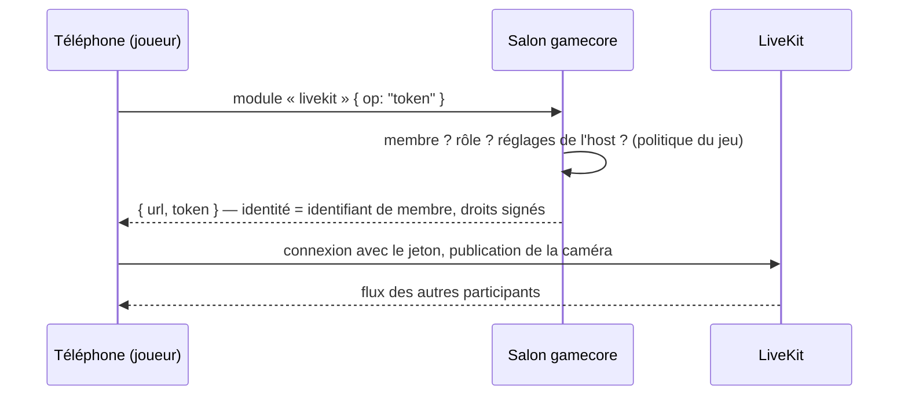

# Vidéo et audio (LiveKit)

`@gamecore/livekit` ajoute les webcams et les micros des joueurs, comme l'« écran géant » de DCDS. La vidéo passe par
[LiveKit](https://livekit.io) (LiveKit Cloud ou serveur auto-hébergé) ; gamecore s'occupe de **qui a le droit de
quoi**.

## Comment ça marche



- **C'est le salon qui délivre les jetons** : lui seul sait qui est membre, avec quel rôle. Une connexion qui n'est
  pas dans le salon n'obtient rien.
- **L'identité LiveKit est l'identifiant de membre**, signée dans le jeton : impossible de publier sous le nom de
  quelqu'un d'autre ; le nom affiché n'est pas modifiable ; pas de canal de données (tout ce qui compte passe par le
  salon, validé).
- **Droits par rôle** (politique par défaut) : les joueurs publient caméra et micro, les spectateurs regardent et
  écoutent, l'écran partagé est **invisible** dans la salle, les bots n'ont pas d'accès.
- **Salle par salon** : nommée d'après l'identifiant aléatoire du salon (jamais réutilisé, contrairement au code) ; un
  ancien jeton n'ouvre donc pas la salle d'un nouveau salon qui aurait le même code.
- **Le secret LiveKit ne quitte jamais le serveur** ; jetons valables 2 h, 10 par minute et par connexion.

## Mise en place

### 1. Serveur LiveKit

LiveKit Cloud (Settings → Keys) donne `LIVEKIT_URL` (`wss://…livekit.cloud`), `LIVEKIT_API_KEY` et
`LIVEKIT_API_SECRET`. En local : `livekit-server --dev` (clé `devkey`, secret `secret`, `ws://127.0.0.1:7880`).

### 2. Côté serveur du jeu

```ts
import { livekitModule } from "@gamecore/livekit/server";

new GameServer({
  game: monJeu,
  modules: [
    livekitModule({
      url: process.env.LIVEKIT_URL!,
      apiKey: process.env.LIVEKIT_API_KEY!,
      apiSecret: process.env.LIVEKIT_API_SECRET!,
      // Facultatif : ce que chacun peut publier, d'après les réglages de l'host (null = pas de vidéo).
      policy: ({ member, settings }) => {
        const { camera, micro } = settings as MesReglages;
        if (!camera && !micro) return null;
        const joueur = member?.role === "player";
        return { publish: { camera: joueur && camera, microphone: joueur && micro } };
      },
    }),
  ],
});
```

**CSP** : autorise l'origine du serveur LiveKit dans `connect-src` (et elle seule), et la caméra et le micro pour la
page (`Permissions-Policy: camera=(self), microphone=(self)`). Le serveur du Buzzer le fait automatiquement quand
`LIVEKIT_URL` est défini ([`server/index.ts`](../examples/buzzer/server/index.ts)).

### 3. Côté interface

```tsx
import { LiveKitMedia, MemberVideo, useMedia } from "@gamecore/livekit/react";

<GameProvider client={client}>
  <LiveKitMedia enabled={room.settings.camera} onSpeakingChange={(on) => audio.setDuck(on)}>
    <MemberVideo memberId={joueur.id} fallback={<Avatar … />} />
    <MesCommandes />
  </LiveKitMedia>
</GameProvider>;

function MesCommandes() {
  const { local } = useMedia(); // null si je ne publie rien
  return local?.canCamera ? <button onClick={local.toggleCam}>{local.camOn ? "Couper" : "Allumer"}</button> : null;
}
```

| API                  | Rôle                                                                                          |
| -------------------- | --------------------------------------------------------------------------------------------- |
| `LiveKitMedia`       | Demande le jeton au salon (et le redemande quand mes droits changent), se connecte            |
| `useMedia()`         | `tiles` (par membre : vidéo, parle, caméra/micro coupés), `local`, `someoneSpeaking`, `error` |
| `useMemberMedia(id)` | Médias d'un membre                                                                            |
| `MemberVideo`        | Vidéo d'un membre, ou `fallback`                                                              |
| `LocalMedia`         | Webcam locale seule, sans serveur (mode démo)                                                 |
| `onSpeakingChange`   | Brancher `audio.setDuck` : la musique baisse quand quelqu'un parle                            |

Sans module « livekit » sur le salon, `LiveKitMedia` laisse passer les médias fournis plus haut (par exemple
`LocalMedia` en mode démo).

## Dans le Buzzer

- Réglages « Caméras » et « Micros » de l'host (visibles seulement si le serveur a LiveKit).
- Écran de l'hôte : la webcam remplace l'avatar dans les pastilles et le classement ; bandeau des webcams pendant la
  partie ; contour vert quand quelqu'un parle.
- Téléphone : boutons caméra et micro, aperçu de sa webcam.
- Mode démo : webcam locale, partagée par l'écran et le téléphone de la page.

## Tests

- Unitaires ([`packages/livekit/src`](../packages/livekit/src)) : jetons décodés et signatures vérifiées, droits par
  rôle, écran invisible, politique, limites ; fournisseur React et tuiles.
- Bout en bout ([`e2e/media.spec.ts`](../e2e/media.spec.ts)) avec la fausse caméra de Chromium : webcam du mode démo ;
  et, en CI, avec un **vrai serveur LiveKit** : la webcam d'un joueur arrive sur l'écran de l'hôte et disparaît quand
  l'host coupe les caméras, sans erreur de CSP. En local, ce test est sauté sauf si `LIVEKIT_URL`,
  `LIVEKIT_API_KEY` et `LIVEKIT_API_SECRET` sont définis.
