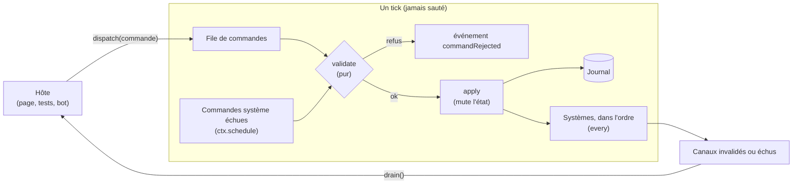
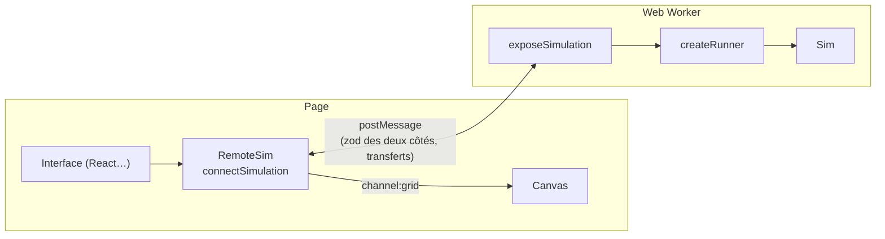

# Simulation continue (`@gamecore/sim`)

`@gamecore/sim` est le second moteur de gamecore, pour les jeux qui **avancent seuls** : écosystème, ville, économie,
gestion. La simulation tourne à tick fixe sur un état volumineux qu'elle modifie en place ; l'interface lui envoie
des commandes et ne reçoit que ce qui a changé. Elle est déterministe (même graine + mêmes commandes = même partie),
sauvegardable, rejouable, et tourne aussi bien dans la page que dans un Web Worker, sous Node ou sous Cloudflare.

Le pourquoi est détaillé dans l'[ADR 0004](adr/0004-moteur-de-simulation-continue.md) ; l'exemple complet est
[examples/sim-playground](../examples/sim-playground/README.md) (« Renards et lapins »).

- [Deux moteurs : lequel choisir ?](#deux-moteurs--lequel-choisir-)
- [Concepts](#concepts)
- [Créer une simulation, pas à pas](#créer-une-simulation-pas-à-pas)
- [Hôtes : mémoire, cadenceur, Worker](#hôtes--mémoire-cadenceur-worker)
- [Protocole](#protocole)
- [Sauvegarde et migrations](#sauvegarde-et-migrations)
- [Tests de déterminisme et de performance](#tests-de-déterminisme-et-de-performance)
- [Pièges du déterminisme](#pièges-du-déterminisme)
- [Performances](#performances)
- [Limites connues](#limites-connues)

## Deux moteurs : lequel choisir ?

|                     | `defineGame` (`@gamecore/core`)                     | `defineSimulation` (`@gamecore/sim`)                    |
| ------------------- | --------------------------------------------------- | ------------------------------------------------------- |
| Le temps            | Avance quand quelqu'un agit (et sur minuteur)       | Avance seul, à tick fixe (3 à 30 ticks/s)               |
| L'état              | Petit (quelques Ko), **copié** à chaque action      | Gros (plusieurs Mo, `TypedArray`), **modifié en place** |
| Une action invalide | `ctx.reject` : la copie est jetée                   | `validate` (pur) refuse avant toute mutation            |
| Ce que reçoit l'UI  | Sa vue complète après chaque action (`sync`)        | Des canaux indépendants, publiés quand ils changent     |
| Les secrets         | Vues par destinataire (public, privé)               | Non (une seule interface, celle de l'hôte)              |
| Hébergement         | Salon autoritaire (`@gamecore/server`), multijoueur | Page, Web Worker, Node ; dans une `Room` plus tard      |
| Exemples            | Quiz, jeu de cartes, jeu de plateau                 | Écosystème, ville, trafic, usine                        |

**Règle simple** : si le jeu ne bouge pas quand personne ne joue, c'est `defineGame`. S'il continue de vivre, c'est
`defineSimulation`. Les deux partagent le RNG SFC32, zod, `GameError` et la même philosophie : des règles pures, un
hôte interchangeable.

## Concepts



### L'état

Un objet ordinaire, créé par `create` et **possédé par le moteur** : les systèmes le modifient en place, le moteur ne
le copie jamais. Mettez les grandes données dans des `TypedArray` alloués une fois (`Uint8Array` pour une grille,
`Float32Array` pour des positions…). Un tampon de travail (« brouillon ») peut vivre dans l'état ; il faut alors
l'exclure du hash et de la sauvegarde (voir l'exemple, champ `moved`).

### Les commandes

- **Commandes de l'hôte** (`commands`, schéma zod) : `dispatch` les valide **tout de suite** (`BAD_REQUEST` sinon), les
  met en file et renvoie un numéro (`seq`). Elles sont appliquées au **début du tick suivant**, dans l'ordre d'arrivée.
- **`validate`** (facultatif) : fonction **pure** (ni hasard, ni effet) qui renvoie un message de refus ou `null`.
  Un refus émet l'événement `commandRejected { seq, key, origin, message }` et la commande n'est pas journalisée. Une
  exception dans `validate` vaut refus (l'état n'a pas bougé).
- **`apply`** : applique la commande acceptée. Elle **ne doit jamais lever après avoir muté** l'état : c'est pour cela
  que les refus se font dans `validate`.
- **Commandes système** (`systemCommands`) : programmées par la simulation elle-même avec
  `ctx.schedule(clé, délaiEnTicks, commande)` et annulées avec `ctx.cancel(clé)`. Une seule par clé (reprogrammer
  remplace). Elles passent par `validate` et `apply` avec `ctx.origin === "system"`. Envoyée par l'hôte, une commande
  système est refusée avant même la validation (`FORBIDDEN`).

### Les systèmes

Des fonctions `update(state, ctx)` exécutées **dans l'ordre déclaré** à chaque tick, ou tous les `every` ticks (un
recensement toutes les 5 secondes, par exemple). Chacun est chronométré sans allocation (`sim.profile()`).

### Les canaux

`snapshot.full` décrit tout ce qu'il faut pour (re)démarrer une interface ; `snapshot.channels` découpe ce que
l'interface suit au fil de l'eau (`grid`, `stats`…). Un canal est publié au `drain` suivant quand :

- il est **échu** : `every: n` le republie tous les `n` ticks ;
- ou il a été **invalidé** : `ctx.invalidate("stats")` dans `apply` ou un système.

Un canal peut renvoyer une **vue directe** de l'état (aucune copie). `transfer: true` indique une donnée binaire
(`TypedArray`, `ArrayBuffer`) que le Worker recopie **une fois** puis transfère à la page sans autre copie.

### Le journal

Chaque commande de l'hôte **acceptée** est journalisée : `{ tick, seq, command }`, où `tick` est le tick pendant
lequel elle a été appliquée. Avec la graine et les réglages, le journal suffit à **rejouer** la partie (`replay`).

- `journalRetention: n` ne garde que les `n` derniers ticks (`journalFrom` indique alors le premier tick complet).
- Au-delà de `maxJournalEntries` (100 000), le journal est **compacté** : une sauvegarde de base est prise
  (`sim.journalBase`) et le journal repart de zéro ; on rejoue alors depuis cette base.

### Numérotation des ticks

`sim.tick` compte les ticks **terminés** (0 au départ, 60 après `step(60)`). Dans le contexte, `ctx.tick` est le
numéro du tick **en cours** (1 pour le premier, 0 dans `create`).

### Le contexte

|                             | `create` | `validate` | `apply` | systèmes | canaux |
| --------------------------- | :------: | :--------: | :-----: | :------: | :----: |
| `tick`, `settings`          |    ✅    |     ✅     |   ✅    |    ✅    |   ✅   |
| `random` (SFC32 sauvegardé) |    ✅    |            |   ✅    |    ✅    |        |
| `emit(nom, données?)`       |    ✅    |            |   ✅    |    ✅    |        |
| `schedule`, `cancel`        |    ✅    |            |   ✅    |    ✅    |        |
| `invalidate(canal)`         |    ✅    |            |   ✅    |    ✅    |        |
| `origin` (`host`, `system`) |          |     ✅     |   ✅    |          |        |
| `profile` (derniers temps)  |    ✅    |            |   ✅    |    ✅    |        |

Les réglages sont **gelés** : les modifier lève une erreur (ils sont sauvegardés à part et le rejeu en dépend).

## Créer une simulation, pas à pas

On suit [`examples/sim-playground/src/simulation.ts`](../examples/sim-playground/src/simulation.ts).

### 1. Réglages et état

```ts
import { ByteReader, ByteWriter, defineSimulation, hashState } from "@gamecore/sim";
import { z } from "zod";

export const foxesAndRabbits = defineSimulation({
  id: "foxes-and-rabbits", // /^[a-z][a-z0-9-]{1,31}$/
  version: 1, // version du format d'état (migrations)
  ticksPerSecond: 10, // cadence à vitesse ×1
  settings: {
    schema: z.strictObject({ size: z.number().int().min(16).max(512), seasonTicks: z.number().int().min(10) }),
    defaults: { size: 128, seasonTicks: 150 },
  },
  // … commandes (étape 2)

  // Déclarer `create` en premier, avec son type de retour, aide TypeScript à inférer l'état partout ailleurs.
  create(ctx): EcoState {
    const { size } = ctx.settings;
    const cells = new Uint8Array(size * size);
    for (let i = 0; i < cells.length; i++) if (ctx.random.next() < 0.15) cells[i] = RABBIT;
    ctx.schedule("season", ctx.settings.seasonTicks, { type: "season", index: 1 });
    return { size, cells, energy: new Uint16Array(size * size), season: 0 /* … */ };
  },
```

`defineSimulation` vérifie la définition **au chargement** (identifiant, version, cadence entre 0 et 240, réglages par
défaut conformes au schéma, noms de systèmes uniques, `every` entiers, noms de canaux, migrations antérieures à la
version) et lève une erreur explicite plutôt qu'au premier tick.

### 2. Commandes

```ts
  commands: z.discriminatedUnion("type", [
    z.strictObject({ type: z.literal("addRabbits"), x: coord, y: coord, count: z.number().int().min(1).max(1000) }),
  ]),
  systemCommands: z.discriminatedUnion("type", [
    z.strictObject({ type: z.literal("season"), index: z.number().int().min(0).max(3) }),
  ]),

  validate(state, command) {
    if (command.type === "addRabbits" && (command.x >= state.size || command.y >= state.size)) {
      return "Case hors de la carte."; // refus : rien n'a bougé
    }
    return null;
  },

  apply(state, command, ctx) {
    if (command.type === "season") {
      state.season = command.index;
      ctx.schedule("season", ctx.settings.seasonTicks, { type: "season", index: (command.index + 1) % 4 });
      ctx.emit("season", { index: command.index });
      return;
    }
    populate(state, RABBIT, command.x, command.y, command.count, () => ctx.random.next());
    ctx.invalidate("stats");
  },
```

### 3. Systèmes

```ts
  systems: [
    { name: "animals", update(state, ctx) { /* déplacements, chasse, reproduction : en place */ } },
    { name: "census", every: 5, update(state, ctx) { countAnimals(state); ctx.invalidate("stats"); } },
  ],
```

### 4. Canaux

```ts
  snapshot: {
    full: (state, ctx) => ({ size: state.size, season: state.season, tick: ctx.tick }),
    channels: {
      grid: { every: 1, build: (state) => state.cells, transfer: true }, // la grille, à chaque tick
      stats: { build: (state) => ({ rabbits: state.rabbits, foxes: state.foxes }) }, // quand on l'invalide
    },
  },
```

Les noms des canaux sont inférés : `ChannelName<typeof foxesAndRabbits>` vaut `"grid" | "stats"`, et
`remote.on("channel:grid", …)` est vérifié par TypeScript.

### 5. Codec et hash

```ts
  codec: {
    encode: (state) => new ByteWriter().u16(state.size).u8(state.season).typed(state.cells).typed(state.energy).finish(),
    decode(bytes) {
      const r = new ByteReader(bytes); // toute lecture au-delà de la fin lève (fichier tronqué)
      const size = r.u16();
      const season = r.u8();
      const cells = r.uint8Array();
      const energy = r.uint16Array();
      if (cells.length !== size * size) throw new RangeError("Grille incohérente."); // revalider !
      return { size, season, cells, energy, moved: new Uint8Array(size * size) };
    },
  },
  // Facultatif : par défaut, hashState(state). Ici, sans le brouillon `moved`.
  hash: (state) => hashState([state.size, state.season, state.cells, state.energy]),
});
```

Le codec ne s'occupe que de l'état : le moteur sauvegarde lui-même le tick, le RNG, les réglages, la graine, le
journal et les commandes programmées. `decode` doit **revalider** ce qu'il lit : un fichier de sauvegarde peut venir
de n'importe où.

### 6. Tester

```ts
import { createSimulation } from "@gamecore/sim";
import { expectDeterministic } from "@gamecore/sim/testing";

const sim = createSimulation(foxesAndRabbits, { seed: "test", settings: { size: 16 } });
sim.dispatch({ type: "addRabbits", x: 8, y: 8, count: 20 });
sim.step(10);
expect(sim.state.rabbits).toBeGreaterThan(20);

expectDeterministic(foxesAndRabbits, {
  seed: "d",
  ticks: 10_000,
  commands: [{ tick: 1, command: {/* … */} }],
});
```

## Hôtes : mémoire, cadenceur, Worker

### En mémoire : `createSimulation`

```ts
const sim = createSimulation(foxesAndRabbits, { seed: "abc", settings: { size: 128 } });
sim.dispatch({ type: "addRabbits", x: 3, y: 4, count: 10 }); // { ok: true, seq } ou { ok: false, error }
sim.step(60); // 60 ticks
sim.tick; // 60
sim.snapshot(); // { tick, full, channels } : tous les canaux
sim.drain(); // { tick, channels, events, droppedEvents } depuis le dernier drain
sim.hash(); // tick + RNG + état + commandes programmées
sim.save(); // Uint8Array (format GCSIM)
sim.journal; // [{ tick, seq, command }]
sim.profile(); // { tickMs: { last, avg }, systems: { animals: { last, avg, runs } } }
sim.state; // accès direct : tests, bots, outils
```

| Option              | Défaut            | Rôle                                                    |
| ------------------- | ----------------- | ------------------------------------------------------- |
| `seed`              | aléatoire         | Graine du RNG ; conservée pour le rejeu                 |
| `settings`          | `defaults`        | Fusionnés avec les valeurs par défaut, validés, gelés   |
| `journalRetention`  | complet           | Ne garder que les commandes des `n` derniers ticks      |
| `maxJournalEntries` | 100 000           | Seuil de compaction du journal                          |
| `maxQueuedCommands` | 10 000            | Au-delà, `dispatch` répond `RATE_LIMITED`               |
| `maxBufferedEvents` | 10 000            | Au-delà, les plus anciens tombent (`droppedEvents`)     |
| `clock`, `profile`  | `performance.now` | Horloge du profilage (n'influence jamais la simulation) |

**Échec franc** : une exception dans `apply` ou dans un système met la simulation en état **corrompu** :
`sim.corrupted` vaut `{ tick, system, cause }`, l'événement `corrupted` est émis, `step` n'exécute plus rien,
`dispatch` répond `INTERNAL` et `save` refuse. On ne continue jamais sur un état à moitié modifié.

### Cadencé : `createRunner`

```ts
const runner = createRunner(sim, {
  ticksPerSecond: 10, // par défaut : celui de la définition
  speed: 1, // 0 = pause
  maxTicksPerFrame: 30,
  now: () => performance.now(), // injectable (tests : createFakeClock)
  schedule: (fn, delayMs) => setTimeout(fn, delayMs), // ou requestAnimationFrame
  onLag: (ticksBehind) => {},
  onDrain: (payload) => {}, // canaux + événements après chaque rafale
});
runner.start();
runner.pause();
runner.setSpeed(4);
runner.step(1);
runner.stop();
runner.stats();
```

**Accumulateur à pas fixe** : le temps écoulé × vitesse × cadence s'accumule ; chaque frame exécute autant de ticks
**entiers** qu'il en contient (compté en « ms × ticks/s » pour rester exact avec une horloge entière). Si une frame
doit rattraper plus de `maxTicksPerFrame` ticks (onglet en arrière-plan, machine lente), elle en exécute
`maxTicksPerFrame`, signale le reste (`onLag`) et **abandonne cette dette** : la vitesse réelle descend sous la cible
au lieu de geler la page. Le nombre de ticks exécutés reste exact et la simulation ne voit jamais le temps : le rejeu
ne dépend pas de la machine.

### Dans un Web Worker : `exposeSimulation` et `connectSimulation`

```ts
// sim.worker.ts
import { exposeSimulation } from "@gamecore/sim/worker";
import { foxesAndRabbits } from "./simulation";
exposeSimulation(foxesAndRabbits, self);
```

```ts
// page
import { connectSimulation } from "@gamecore/sim/worker-client";
const worker = new Worker(new URL("./sim.worker.ts", import.meta.url), { type: "module" });
const remote = connectSimulation<typeof foxesAndRabbits>(worker);
remote.on("channel:grid", (cells) => draw(cells as Uint8Array));
remote.on("event:season", (data, tick) => notify(data));
await remote.init({ seed: "abc" }); // ou remote.load(octets)
await remote.dispatch({ type: "addRabbits", x: 3, y: 4, count: 10 }); // → seq, ou GameError
await remote.setSpeed(2);
await remote.pause();
await remote.step(1);
await remote.resume();
const bytes = await remote.save(); // transférés depuis le Worker
```



- `RemoteSim` a le même contrat que `Sim`, en asynchrone : chaque requête est corrélée par un `id` et rejetée avec un
  `GameError` (`TIMEOUT` après 10 s, `DISCONNECTED` après `close()`).
- Événements : `ready`, `snapshot` (après `ready`), `tick` (après chaque rafale : tick, cadence réelle, retard),
  `channel:<nom>`, `event:<nom>`, `events`, `commandRejected`, `lag`, `corrupted`, `error`. `remote.latest(canal)`
  renvoie la dernière donnée reçue ; `remote.subscribe(["stats"])` limite les canaux envoyés.
- Le port est **structurel** (`{ postMessage(message, { transfer }), onmessage }`) : un `Worker`, le `self` d'un
  Worker ou un `MessagePort` conviennent, sans la bibliothèque de types `WebWorker` (qui entre en conflit avec `DOM`).
- **Sans Worker** : `localPort()` crée deux ports reliés en mémoire (livraison asynchrone, messages clonés et
  transférés comme par un vrai Worker). Le même code sert aux tests et au mode démo :

```ts
const [pagePort, simPort] = localPort();
exposeSimulation(foxesAndRabbits, simPort);
const remote = connectSimulation<typeof foxesAndRabbits>(pagePort);
```

## Protocole

Défini dans [`packages/sim/src/protocol.ts`](../packages/sim/src/protocol.ts) (`hostMessageSchema`,
`workerMessageSchema`) et **validé par zod des deux côtés**, même si l'autre côté est le nôtre.

| Page → simulation                                | Réponse                 | Rôle                                         |
| ------------------------------------------------ | ----------------------- | -------------------------------------------- |
| `init { id, seed?, settings?, speed?, paused? }` | `ready` puis `snapshot` | Nouvelle simulation                          |
| `load { id, bytes, speed?, paused? }`            | `ready` puis `snapshot` | Chargement d'une sauvegarde                  |
| `dispatch { id, command }`                       | `ack { data: seq }`     | Commande de l'hôte                           |
| `control { id, control }`                        | `ack`                   | `speed`, `pause`, `resume`, `step { ticks }` |
| `subscribe { id, channels \| null }`             | `ack`                   | Canaux à recevoir (`null` : tous)            |
| `snapshot { id }`                                | `snapshot { id, … }`    | Snapshot complet                             |
| `hash { id }`                                    | `ack { data: hash }`    | Hash courant                                 |
| `save { id }`                                    | `saved { id, bytes }`   | Sauvegarde (octets transférés)               |

Toute requête peut recevoir `error { id, code, message }` (codes de `@gamecore/core`). Messages spontanés de la
simulation : `snapshot` (après `ready`), `channel { name, data, tick }`, `events { tick, events, dropped, tps,
lagging }` (après chaque rafale, même vide), `lag { tick, ticksBehind }`, `corrupted { tick, system, cause }`, et
`error { id: null }` pour un message invalide.

## Sauvegarde et migrations

`sim.save()` (ou `encodeSave(sim)`) produit un fichier binaire **GCSIM** :

| Champ                            | Contenu                                               |
| -------------------------------- | ----------------------------------------------------- |
| `"GCSIM"`, version d'en-tête (1) | Signature et format                                   |
| `id`, `version`                  | Simulation et version du format d'état                |
| `tick`, état du RNG              | Pour reprendre exactement                             |
| réglages (JSON), graine          | La graine permet le rejeu                             |
| `seq`, `journalFrom`, journal    | Numérotation des commandes et journal conservé (JSON) |
| commandes programmées (JSON)     | Elles survivent à la sauvegarde                       |
| hash                             | Hash de la simulation au moment de la sauvegarde      |
| état                             | `codec.encode(state)`                                 |

- `loadSimulation(definition, octets, options?)` recrée la simulation ; `decodeSave(definition, octets)` lit le
  contenu sans la créer (`{ state, tick, rng, settings, seed, journal, scheduled, hash, … }`).
- **Fichiers non fiables** : taille bornée (`maxBytes`, 64 Mio), en-tête, JSON, journal et commandes programmées
  revalidés (zod et schémas de la définition), ticks et numéros cohérents, données en trop refusées. Après
  chargement, le hash de l'état rechargé est comparé à celui du fichier (`verifyHash`, actif par défaut) : un fichier
  altéré ou un codec qui ne restitue pas tout l'état est refusé. Toute anomalie lève `GameError("BAD_REQUEST")`.
- **Migrations** : `migrate: { 1: (octetsV1) => octetsV2, 2: … }` s'appliquent en chaîne jusqu'à `version`. Le journal
  d'une sauvegarde migrée est **abandonné** (`journalFrom` = tick + 1) : ses commandes suivaient des règles
  antérieures. Les réglages sont fusionnés avec les valeurs par défaut actuelles (un nouveau réglage prend sa valeur
  par défaut) ; les commandes programmées doivent rester valides pour le schéma actuel.

### Rejeu

```ts
import { decodeSave, replay } from "@gamecore/sim";
const saved = decodeSave(foxesAndRabbits, bytes);
const again = replay(foxesAndRabbits, {
  seed: saved.seed,
  settings: saved.settings,
  journal: saved.journal,
  untilTick: saved.tick,
});
again.hash() === saved.hash; // true : la simulation est déterministe
// Après une compaction : replay(def, { base: sim.journalBase, journal: sim.journal, untilTick: sim.tick })
```

## Tests de déterminisme et de performance

Outils de `@gamecore/sim/testing` (ils lèvent des erreurs ordinaires : n'importe quel lanceur de tests convient).

### `expectDeterministic(definition, script, options?)`

```ts
expectDeterministic(foxesAndRabbits, {
  seed: "déterminisme",
  settings: { size: 64 },
  ticks: 10_000,
  commands: [{ tick: 1, command: { type: "addFoxes", x: 32, y: 32, count: 50 } }],
});
```

Le scénario est vérifié de trois façons :

1. **deux exécutions en parallèle**, hashs comparés tous les `checkEvery` ticks (100) ;
2. la seconde est **sauvegardée puis rechargée** en cours de route (`saveAt`, milieu par défaut) : détecte un codec
   infidèle ou un état caché hors de `state` (variable de module, fermeture) ;
3. le journal est **rejoué** depuis la graine à la fin.

Pendant l'exécution, `Math.random`, `Date.now` et `new Date()` lèvent une erreur (`guards`). En cas d'écart, la
`DeterminismError` donne le **premier tick divergent** (recherché tick par tick depuis le dernier contrôle réussi).

### `benchmark(definition, script, options?)`

Mesure le temps d'un tick et de chaque système (moyenne, p50, p95, max) après un échauffement, et la variation du tas
quand l'environnement l'expose (Node : `heapDeltaBytes`, indicatif à cause du ramasse-miettes — JavaScript n'expose
pas de compteur d'allocations). Utilisez un seuil **large** en CI (l'exemple exige p95 < 20 ms pour un budget de
100 ms).

### `createFakeClock()`

Fausse horloge pour `createRunner` : le temps n'avance que sur `clock.advance(ms)`, qui exécute les frames
programmées dans l'ordre.

```ts
const clock = createFakeClock();
const runner = createRunner(sim, { now: clock.now, schedule: clock.schedule, cancel: clock.cancel });
runner.start();
clock.advance(1000); // exactement 10 ticks à 10 ticks/s
```

## Pièges du déterminisme

`expectDeterministic` en attrape la plupart ; les connaître évite de les écrire.

- **Hasard et horloge** : tout le hasard passe par `ctx.random` (dont l'état est sauvegardé), le temps par `ctx.tick`.
  Jamais `Math.random()`, `Date`, `performance.now()` dans le chemin de simulation. `crypto.getRandomValues` non plus.
- **Ordre d'itération** : `Object.keys` d'un objet construit dans un ordre variable, `Set` et `Map` remplis selon des
  événements extérieurs, `sort` avec un comparateur incohérent. Préférez des tableaux indexés, et triez avec un
  critère total (à égalité, un identifiant).
- **État caché** : une variable de module ou une fermeture modifiée par un système n'est ni sauvegardée ni hachée ; le
  rechargement ou une seconde instance divergent. Tout ce qui compte doit être dans `state`.
- **Brouillons** : un tampon de travail dans l'état doit être remis à zéro avant usage et exclu du hash (option
  `hash`) et du codec.
- **Flottants** : sur une même machine, les calculs sont reproductibles. D'un moteur JavaScript à l'autre,
  `Math.sin`, `Math.exp`, `Math.pow`… peuvent différer au dernier bit (leur précision n'est pas imposée par la norme).
  Si un rejeu doit être identique sur toutes les machines, gardez l'état en entiers ou en virgule fixe et évitez ces
  fonctions dans le chemin de simulation. Attention aussi aux `Float32Array` : chaque écriture arrondit.
- **Asynchrone** : aucun `await`, `Promise` ni minuteur dans `apply` ou un système : un tick est synchrone.
- **Effets de bord** : `validate` et les `build` de canaux ne modifient rien ; les événements (`ctx.emit`) n'influencent
  pas l'état. `ctx.random.shuffle` alloue une copie : évitez-le dans les boucles chaudes.
- **Commandes** : elles sont journalisées et sauvegardées en JSON ; gardez-les sérialisables (pas de `Date`, de
  `TypedArray` ni de `bigint`).

## Performances

Le moteur garantit l'absence d'allocation évitable dans sa boucle de tick : file de commandes vidée en place,
contextes créés une fois, temps mesurés dans des `Float64Array`, aucune copie de l'état (un test vérifie que
`structuredClone` n'est jamais appelé). Seuls les événements émis et les entrées du journal créent des objets.

Ce qui reste à votre charge :

- **Vos systèmes** : allouez les tampons dans `create`, réutilisez-les ; parcourez des `TypedArray` ; évitez les
  fermetures et les tableaux temporaires dans les boucles (l'exemple calcule les voisins sans modulo, dans un tampon
  réutilisé, et tient en environ 0,3 ms par tick pour 16 384 cases peuplées).
- **Les canaux transférés** : le Worker recopie la donnée une fois par publication (`slice`) avant de la transférer —
  pour une grille de 128 × 128 octets à 10 ticks/s, 160 Ko/s. Réduisez la fréquence (`every`) d'un gros canal si
  l'interface n'a pas besoin de chaque tick.
- **Le hash** parcourt tout l'état octet par octet : il sert aux tests, aux sauvegardes et au rejeu, pas à chaque tick.

## Limites connues

- **Un seul fil** : une simulation s'exécute dans un seul Worker ; un tick trop long ralentit la cadence (le cadenceur
  le signale par `onLag` et `stats().lagging`).
- **Pas encore de multijoueur** : héberger une simulation dans une `Room` de `@gamecore/server` (commandes = actions
  validées, canaux = synchronisation différentielle) est prévu ; voir la [feuille de route](feuille-de-route.md).
- **Rejeu** : impossible depuis la graine après une compaction ou une rétention du journal (`journalFrom > 0`) — il
  faut la sauvegarde de base — ni après une migration (journal abandonné).
- **Flottants entre machines** : voir les pièges ; le déterminisme est garanti sur un même moteur JavaScript.
- **Canaux non souscrits** : `drain` construit tous les canaux invalidés ou échus, même ceux que la page ne suit pas
  (la souscription filtre l'envoi, pas la construction).
- **Commandes programmées** : la recherche des échéances est linéaire ; elle reste rapide pour des centaines de clés,
  pas pour des centaines de milliers.
- **Événements** : au-delà de `maxBufferedEvents` sans `drain`, les plus anciens sont perdus (comptés dans
  `droppedEvents`).
- **`RemoteSim.load` transfère les octets** : le tableau passé devient inutilisable (copiez-le avant si besoin).
